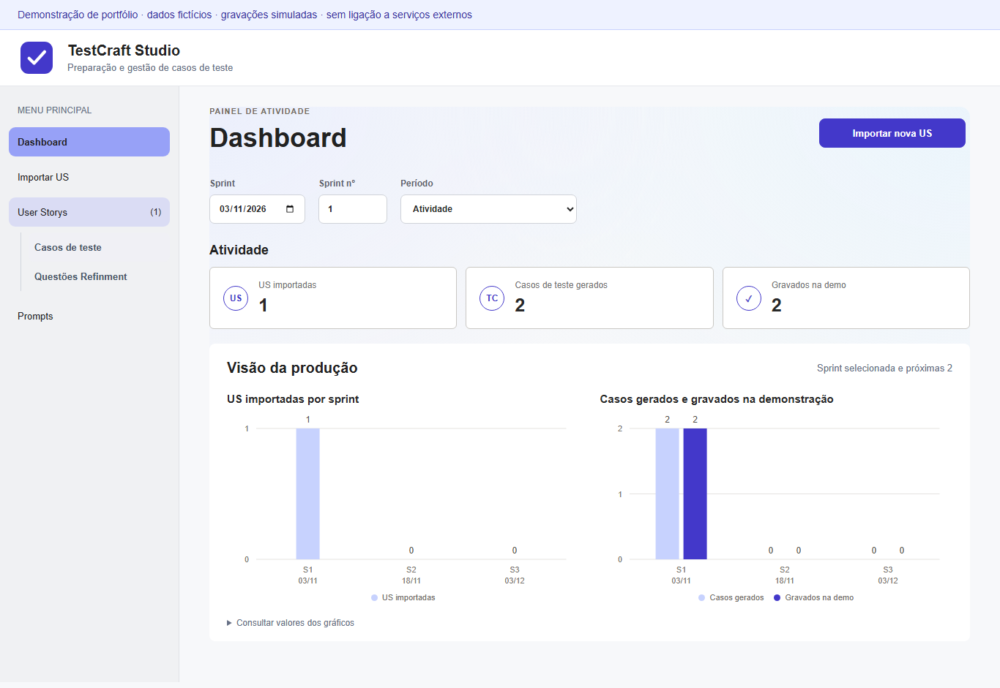

# TestCraft Studio

Demonstração de portfólio para transformar User Stories em casos de teste estruturados, organizar questões de refinement e acompanhar a execução do fluxo de revisão.

**Todos os dados são fictícios. As gravações são simuladas numa API local. Não existe conector ativo para Azure DevOps, autenticação Windows, PAT ou serviços de IA.**

## Executar

Requisitos: Node.js 20.19+ ou 22.12+ e npm. Verificado com Node 26.5.0. Funciona sem PowerShell.

```sh
npm ci
npm run dev
```

Abrir http://127.0.0.1:5173. A API de demonstração escuta apenas em 127.0.0.1:3001. Ctrl+C termina os processos iniciados pelo comando.

## Experimentar em dois minutos

1. Abrir **Importar US** e importar **1001** (carrinho) ou **1002** (recuperação de acesso).
2. Selecionar **Usar resposta de exemplo** e **Importar resposta**. O exemplo é estático e não chama IA.
3. Rever os casos, editar passos ou responder às questões de refinement.
4. Selecionar os casos e escolher **Destino dos selecionados** → **Demo Store** → duplo clique em **Smoke tests** → confirmar destino.
5. Validar e gravar. A modal apresenta IDs simulados, nomes e biblioteca.
6. Consultar o dashboard e os rascunhos que ficam no browser.

Também é possível copiar uma prompt e colar manualmente uma resposta JSON de um assistente à escolha. A aplicação não envia os dados a esse assistente.



## Funcionalidades

- Várias User Stories com estado separado.
- Parser JSON e separação de casos e questões.
- Modal de edição com passos reordenados por inserção no início e remoção.
- Categorias personalizadas de título e prioridades de 1 a 4.
- Árvore de bibliotecas/suites e aplicação do destino em grupo.
- Validação, progresso por caso e lista de pendentes.
- Dashboard por períodos de 15 dias.
- Persistência de rascunhos e métricas no browser.
- Componentes com diálogos nativos e suporte a movimento reduzido.

## Arquitetura

```text
React + TypeScript → /api → Express demo adapter → dados fictícios em memória
        ↓
localStorage isolado com prefixo testcraft-demo-
```

O backend só responde com dados locais. Não inclui código de ligação a organizações, IDs reais, credenciais ou dados de utilizadores reais. Uma futura integração necessita de um adaptador separado e respetivos testes; configurar um endereço ou token não ativa qualquer ligação nesta edição.

As gravações da API vivem em memória e desaparecem ao reiniciar o backend. Os rascunhos do browser persistem no mesmo perfil e endereço. Os IDs mostrados são simulados e não representam work items reais. Para reiniciar a demonstração por completo, limpar os dados deste endereço no browser e reiniciar a API.

## Verificações

```sh
npm run typecheck
npm run test:unit
npm run build
npm run test:e2e:install
npm run test:e2e
```

Os testes de interface iniciam os seus servidores locais, verificam o fluxo completo e detetam pedidos do browser fora da origem local. Os testes da API verificam validação e repetição idempotente.

## Publicar no Git

Publicar apenas esta pasta. Não usar o arquivo da aplicação interna como conteúdo do repositório público.

```sh
git init
git add .
git status
git commit -m "Add TestCraft Studio portfolio demo"
git branch -M main
git remote add origin <URL_DO_REPOSITORIO_PESSOAL>
git push -u origin main
```

O .gitignore exclui dependências, builds, relatórios, variáveis locais e dados de execução. O logótipo SVG e o spinner desta versão são neutros. Não foram incluídos imagens nem logótipos de organizações.

Esta cópia não traz uma licença de distribuição automática. A anonimização protege referências e ligações; a autorização para publicar o código deve ser confirmada por quem o publica.

## Alojamento no Render

Criar um Web Service ligado a este repositório, branch main, pasta raiz vazia.

- Build Command: `npm ci --include=dev && npm run build`
- Start Command: `npm start`
- Environment variable: `NODE_ENV=production`
- Health check: `/api/health`
- Instance type: Free, se disponível na conta.

Em produção o servidor usa a PORT atribuída pela plataforma, escuta em 0.0.0.0 e serve interface compilada e API demo na mesma origem. O modo de demonstração mantém-se: não são ativadas integrações externas. Dados da API continuam em memória e são reiniciados a cada arranque.
